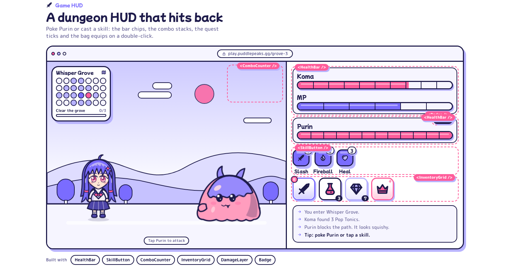
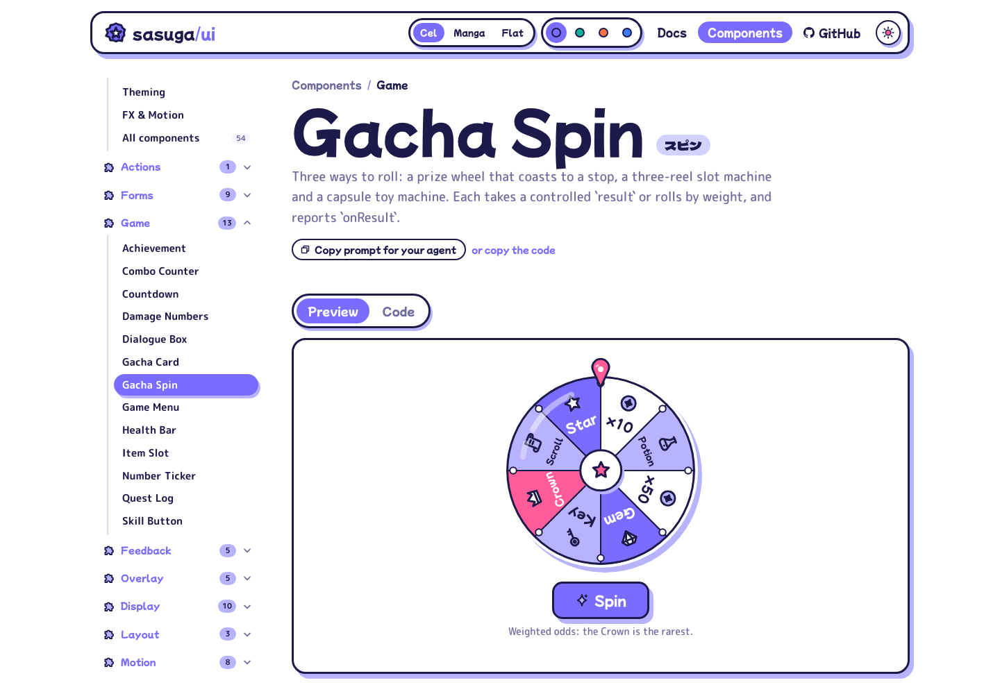

# sasuga/ui

Game-feel UI components for React. Calm, sticker-like controls at rest — then they squash,
overshoot and burst with hand-drawn impact effects and sound-effect lettering when you touch them.
Made for web games, launchers and anime-flavoured apps, and for any interface that should feel alive.

**Docs & live demos → https://codewithwan.github.io/sasuga-ui/**

```bash
npx sasuga init
npx sasuga add button health-bar gacha-card
```


## In real apps

Every screen below is built only from kit components (the pink tags are the docs site's
"Show the components" mode, which labels each one).




Same components, `manga` style in dark mode — one attribute, no class changes:


<table>
  <tr>
    <td width="68%"></td>
    <td></td>
  </tr>
</table>

## What's in it

- **50+ components** — buttons, forms, overlays, menus, text motion, plus game pieces: health bars,
  skill buttons with cooldowns, combo counters, damage numbers, dialogue boxes, gacha cards and spins,
  inventory slots, quest logs, achievements.
- **3 structural styles** — `cel` (thick ink line, sticker shadows), `manga` (square panels,
  screentone), `flat` (calm product UI).
- **4 colours × light / dark**, all from CSS tokens.
- **Springs + a canvas effects layer** — bursts, smoke, speed lines and lettering that adapt to the style.
- **Accessible** — keyboard support, ARIA roles, `prefers-reduced-motion` respected everywhere.
- **Yours to edit** — like shadcn/ui, the code is copied into your project, not imported from a package.
- React 19 · TypeScript · Tailwind CSS v4 · works with Vite and Next.js.

## Install

### CLI

In a React 19 + TypeScript app with Tailwind CSS v4:

```bash
npx sasuga init               # deps, core files, stylesheet import, fonts
npx sasuga add button         # one or more components · or: add --all
npx sasuga list               # every component, by category
```

`init` writes `sasuga.json` (where files go and the import alias). `add` copies each component with
the kit files it needs and installs its npm packages. The registry is generated from this repo and
served with the docs (`/r/index.json`, `/r/<name>.json`).

### By hand

1. `npm i class-variance-authority clsx tailwind-merge`
2. Set up Tailwind v4 and an `@` alias to `src`.
3. Copy the core: `src/index.css`, `src/lib/utils.ts`, `src/lib/theme.ts`, `src/fx/`.
4. Copy the components you want from `src/components/ui/`. Every docs page shows the full source
   and the files it needs ([Installation guide](https://codewithwan.github.io/sasuga-ui/docs/installation)).

### With an AI agent

Every component page has a **Copy prompt for your agent** button with the exact files and raw links,
and [`llms.txt`](https://codewithwan.github.io/sasuga-ui/llms.txt) maps the whole kit.

## Theming

```html
<html data-style="cel" data-theme="lilac" data-mode="light">
```

| Attribute    | Values                             | Changes                                    |
| ------------ | ---------------------------------- | ------------------------------------------ |
| `data-style` | `cel` · `manga` · `flat`           | shape, line, shadow, type, effect loudness |
| `data-theme` | `lilac` · `mint` · `peach` · `sky` | accent colours                             |
| `data-mode`  | `light` · `dark`                   | surfaces                                   |

`useTheme()` / `initTheme()` in `src/lib/theme.ts` switch and remember them. Any docs URL also takes
`?style=manga&theme=mint&mode=dark`. Contributor rules: [`docs/DESIGN.md`](docs/DESIGN.md).

## This repository

```
brand.config.ts       name, package, links — rebrand everything from here
src/components/ui     the kit, one file per component
src/components/art    mascot "Koma", stickers, logo
src/fx                springs + canvas effects engine
src/index.css         tokens, styles, colours, ui-* utilities
src/docs/entries      one docs page per component
cli/                  the `sasuga` CLI (generated package.json from brand.config.ts)
scripts/              registry, CLI build, icons, README screenshots
```

| Script                       | Does                                                      |
| ---------------------------- | --------------------------------------------------------- |
| `npm run dev`                | docs site (+ registry at `/r/`) on localhost              |
| `npm run build`              | type-check + production build (site + registry)           |
| `npm run lint`               | oxlint                                                    |
| `npm run cli:build`          | build the CLI package from `brand.config.ts`              |
| `npm run icons`              | favicons and app icons from `scripts/*.svg`               |
| `bash scripts/screenshots.sh` | these README screenshots (needs `npm run dev`)           |

## Credits

Made by [codewithwan](https://github.com/codewithwan). [MIT License](LICENSE).
