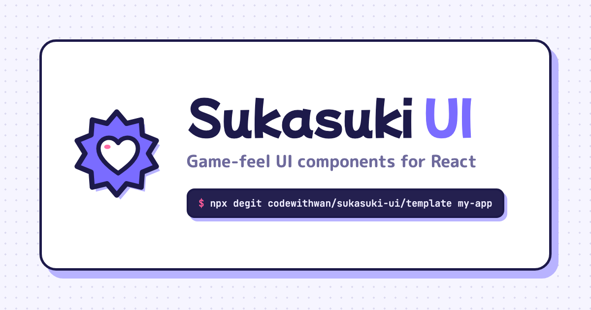

<p align="center">
  
</p>

# Sukasuki UI

Game-feel UI components for React. Calm, sticker-like controls at rest — then they squash,
overshoot and burst with hand-drawn impact effects and sound-effect lettering when you touch them.
Made for web games, launchers and anime-flavoured sites, and for any app that should feel alive.

Copy-paste, shadcn-style: the components live in your project, so you own and edit the code.

- **50+ components** — buttons, forms, overlays, menus, plus game pieces: health bars, skill
  buttons with cooldowns, combo counters, damage numbers, dialogue boxes, gacha cards and spins,
  inventory slots, quest logs, achievements, text motion.
- **3 structural styles** — `cel` (thick ink line, sticker shadows), `manga` (square panels,
  screentone), `flat` (calm product UI) — switched with one attribute, no class changes.
- **4 colours × light / dark**, all from CSS tokens.
- **Springs + a canvas FX layer** — bursts, smoke, speed lines and lettering that adapt to the style.
- **Accessible** — keyboard support, ARIA roles, `prefers-reduced-motion` respected everywhere.
- React 19 · TypeScript · Tailwind CSS v4 · Vite.

## Get started

### New app: use the template

```bash
npx degit codewithwan/sukasuki-ui/template my-app
cd my-app
npm install
npm run dev
```

Or press **Use this template** on GitHub, or download the ZIP and keep the `template` folder.

### Existing app: copy the files

1. `npm i class-variance-authority clsx tailwind-merge`
2. Set up Tailwind v4 and an `@` alias to `src` (Vite + `tsconfig`).
3. Copy the core: `src/index.css`, `src/lib/utils.ts`, `src/lib/theme.ts`, `src/fx/`.
4. Copy the components you want from `src/components/ui/` (and `src/components/art/` for the mascot and stickers).

The full guide is on the docs site under **Docs → Installation**.

## Theming

Everything is driven by attributes on `<html>`:

```html
<html data-style="cel" data-theme="lilac" data-mode="light">
```

| Attribute    | Values                          | Changes                                   |
| ------------ | ------------------------------- | ----------------------------------------- |
| `data-style` | `cel` · `manga` · `flat`        | shape, line, shadow, type, effect loudness |
| `data-theme` | `lilac` · `mint` · `peach` · `sky` | accent colours                          |
| `data-mode`  | `light` · `dark`                | surfaces                                  |

`src/lib/theme.ts` has `useTheme()` / `initTheme()` to switch and remember them. Design rules
for contributors are in [`docs/DESIGN.md`](docs/DESIGN.md).

## This repository

```
src/components/ui     the kit (one file per component)
src/components/art    mascot "Koma", stickers, logo
src/fx                springs + canvas effects engine
src/index.css         tokens, styles, colours, ui-* utilities
src/docs/entries      one docs page per component
src/pages, sections   the docs site and landing page
template/             the starter people download (synced from src)
brand.config.ts       the kit's name, package and links — change it here
```

| Script                  | Does                                              |
| ----------------------- | ------------------------------------------------- |
| `npm run dev`           | docs site on localhost                            |
| `npm run build`         | type-check + production build                      |
| `npm run lint`          | oxlint                                            |
| `npm run template:sync` | copy the kit from `src` into `template/src`        |
| `npm run icons`         | regenerate favicons / app icons from `scripts/`    |

## Credits

Made by [codewithwan](https://github.com/codewithwan). Released under the [MIT License](LICENSE).
