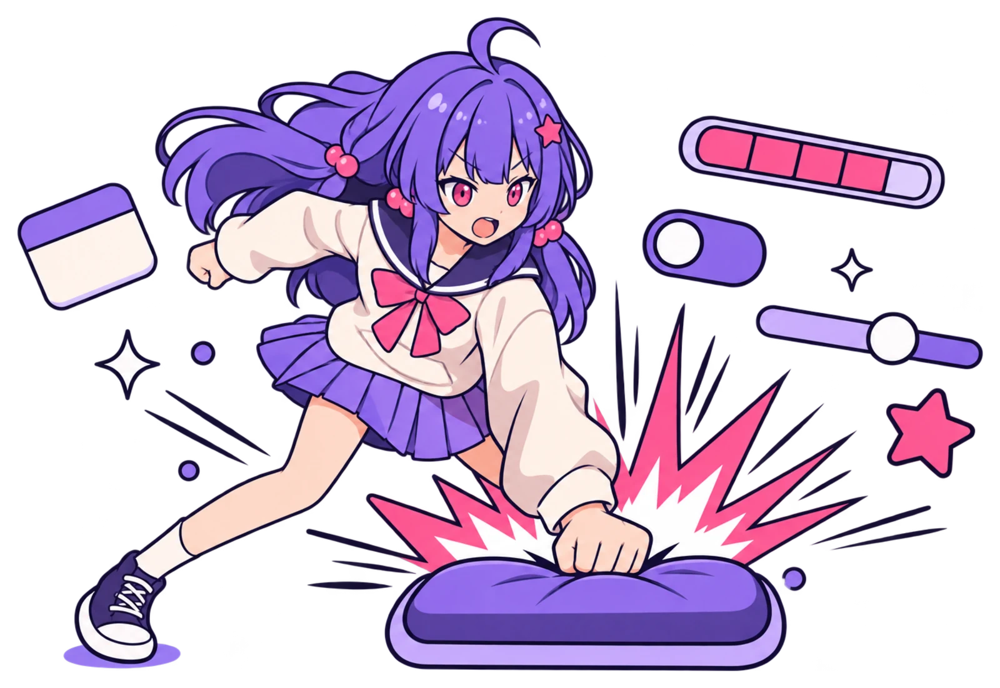
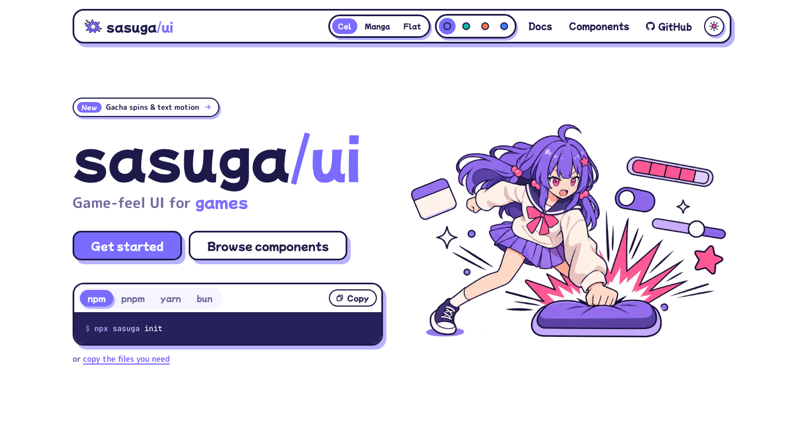
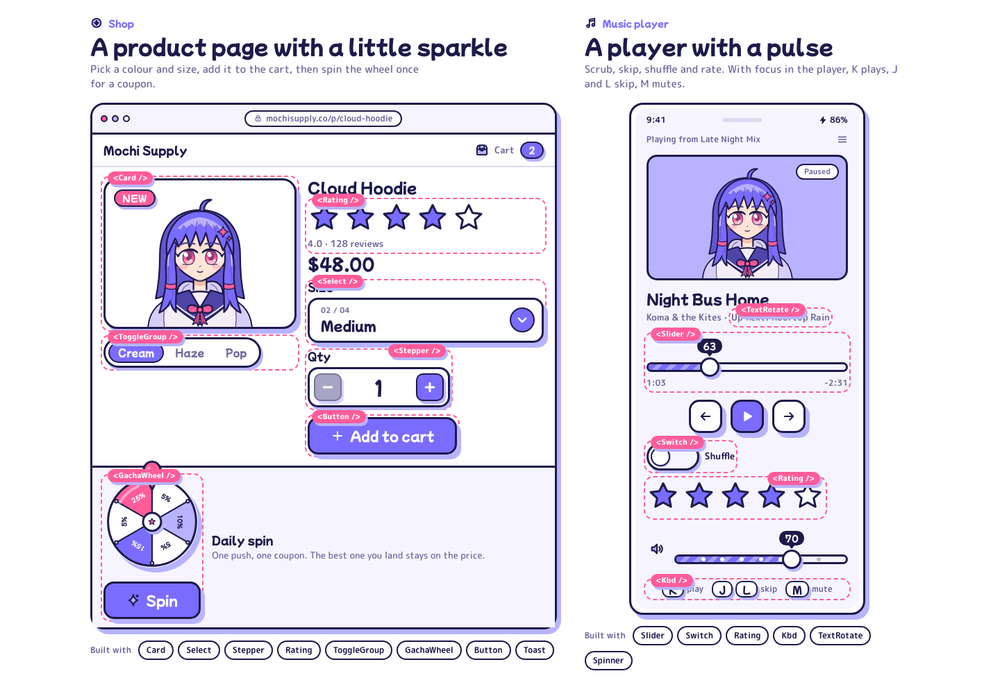
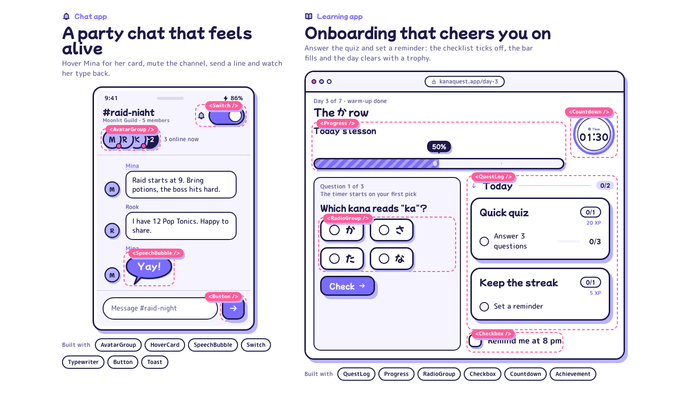
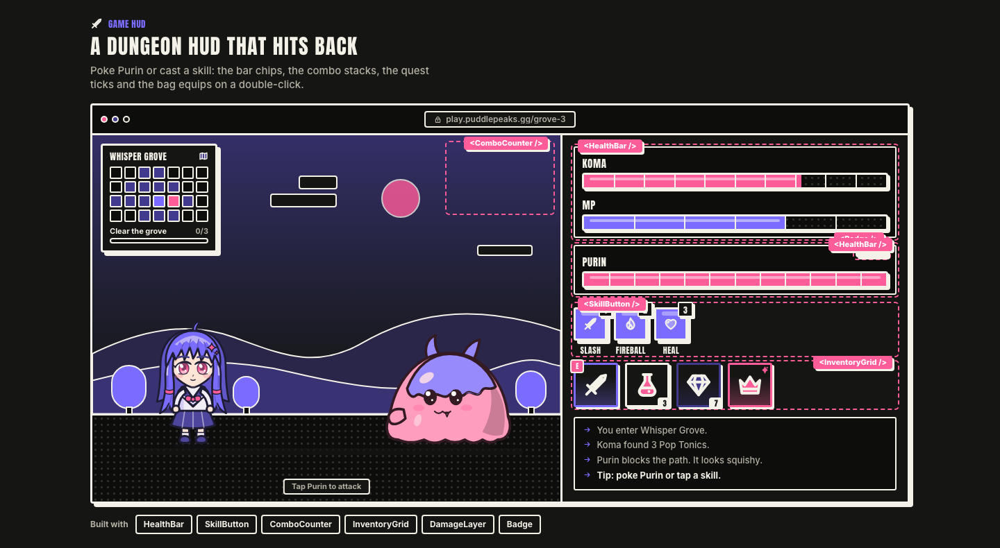
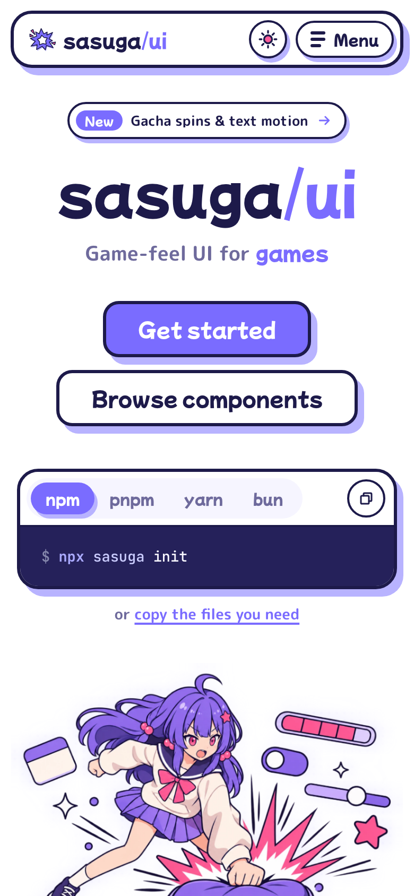

<p align="center">
  
</p>

# sasuga/ui

Game-feel UI components for React. Calm, sticker-like controls at rest — then they squash,
overshoot and burst with hand-drawn impact effects and sound-effect lettering when you touch them.
Made for web games, launchers and anime-flavoured apps, and for any interface that should feel alive.

**Docs & live demos → https://codewithwan.github.io/sasuga-ui/**

```bash
npx sasuga init
npx sasuga add button health-bar gacha-card
```



## In real apps

Every screen below is built only from kit components (the pink tags are the docs site's
"Show the components" mode, which labels each one).






Same components, `manga` style in dark mode — one attribute, no class changes:



<table>
  <tr>
    <td width="68%"></td>
    <td></td>
  </tr>
</table>

## Meet Koma

The kit's mascot. In the components she's hand-built SVG (`Mascot`, `Chibi`) that follows your theme
colours; this art is the reference she's drawn from.

<p align="center">
  
  
  
  
</p>

## What's in it

- **50+ components** — buttons, forms, overlays, menus, text motion, plus game pieces: health bars,
  skill buttons with cooldowns, combo counters, damage numbers, dialogue boxes, gacha cards and spins,
  inventory slots, quest logs, achievements.
- **3 structural styles** — `cel` (thick ink line, sticker shadows), `manga` (square panels,
  screentone), `flat` (calm product UI).
- **4 colours × light / dark**, all from CSS tokens.
- **Springs + a canvas effects layer** — bursts, smoke, speed lines and lettering that adapt to the style.
- **Accessible** — keyboard support, ARIA roles, `prefers-reduced-motion` respected everywhere.
- **Yours to edit** — like shadcn/ui, the code is copied into your project, not imported from a package.
- React 19 · TypeScript · Tailwind CSS v4 · works with Vite and Next.js.

## Install

### CLI

In a React 19 + TypeScript app with Tailwind CSS v4:

```bash
npx sasuga init               # deps, core files, stylesheet import, fonts
npx sasuga add button         # one or more components · or: add --all
npx sasuga list               # every component, by category
```

`init` writes `sasuga.json` (where files go, the import alias, `"framework": "react"`). `add` copies
each component with the kit files it needs and installs its npm packages. The registry is generated
from this repo and served with the docs (`/r/index.json`, `/r/<name>.json`, and `/r/frameworks.json`
for the framework ports).

**Vue and other frameworks:** React only for now. A Vue port has its slot in `packages/vue`; the CLI
recognises Vue projects and points them at the [roadmap](https://codewithwan.github.io/sasuga-ui/roadmap).
Want to help? See [`packages/vue/PORTING.md`](packages/vue/PORTING.md).

### By hand

1. `npm i class-variance-authority clsx tailwind-merge`
2. Set up Tailwind v4 and an `@` alias to `src`.
3. Copy the core into `src/`: `packages/core/src/styles/index.css` → `src/index.css`,
   `packages/core/src/{lib,fx}/` → `src/lib/`, `src/fx/`, then the React adapters
   `packages/react/src/{lib,fx}/` on top (they replace `fx/index.ts` and `lib/theme.ts` and add
   `useSprings` / `useTheme`). [`llms.txt`](https://codewithwan.github.io/sasuga-ui/llms.txt) lists every
   file with its destination.
4. Copy the components you want from `packages/react/src/components/ui/` to `src/components/ui/`.
   Every docs page shows the full source and the files it needs
   ([Installation guide](https://codewithwan.github.io/sasuga-ui/docs/installation)).

### With an AI agent

Every component page has a **Copy prompt for your agent** button with the exact files and raw links,
and [`llms.txt`](https://codewithwan.github.io/sasuga-ui/llms.txt) maps the whole kit.

## Roadmap & requests

The [roadmap](https://codewithwan.github.io/sasuga-ui/roadmap) shows the board (planned / in progress / done),
each framework's port progress and the most-wanted requests.
[Request a component](https://github.com/codewithwan/sasuga-ui/issues/new?template=component-request.yml) ·
[Help port to Vue](https://github.com/codewithwan/sasuga-ui/issues/new?template=framework-port.yml) ·
[Report a bug](https://github.com/codewithwan/sasuga-ui/issues/new?template=bug-report.yml)

## Theming

```html
<html data-style="cel" data-theme="lilac" data-mode="light">
```

| Attribute    | Values                             | Changes                                    |
| ------------ | ---------------------------------- | ------------------------------------------ |
| `data-style` | `cel` · `manga` · `flat`           | shape, line, shadow, type, effect loudness |
| `data-theme` | `lilac` · `mint` · `peach` · `sky` | accent colours                             |
| `data-mode`  | `light` · `dark`                   | surfaces                                   |

`useTheme()` / `initTheme()` from `@/lib/theme` switch and remember them. Any docs URL also takes
`?style=manga&theme=mint&mode=dark`. Contributor rules: [`docs/DESIGN.md`](docs/DESIGN.md).

## This repository

npm workspaces, one lockfile, one root `node_modules`:

```
brand.config.ts              name, package, links — rebrand everything from here
roadmap.json                 framework ports and their status (→ /r/frameworks.json, /docs/roadmap)
apps/docs/                   the docs site (Vite): pages, live demos, registry + llms.txt plugins
  src/docs/entries/          one docs page per component
  public/                    favicons, og-image
packages/core/src/           framework-agnostic, no React import
  styles/index.css           tokens, styles, colours, ui-* utilities
  fx/                        canvas effects engine, springs (createSpring), impacts
  lib/                       cn(), theme store (theme-core.ts)
packages/react/src/          React 19
  components/ui/             the kit, one file per component
  components/art/            mascot "Koma", stickers, monster
  fx/, lib/                  useSprings, useTheme and the `@/fx`, `@/lib/theme` entry files
packages/vue/                the Vue 3 port — not started, see PORTING.md
cli/                         the `sasuga` CLI (generated package.json from brand.config.ts)
scripts/                     registry, CLI build, icons, README screenshots
docs/DESIGN.md               design rules for every port
```

Components import `@/fx`, `@/lib/utils`, `@/lib/theme`, `@/components/ui/*` as if everything sat in
one `src/` (that is how it lands in your app). In the docs app those resolve to `packages/react`
first, then `packages/core` (`apps/docs/vite.config.ts` and `tsconfig.app.json`).

All from the repo root:

| Script                        | Does                                                               |
| ----------------------------- | ------------------------------------------------------------------ |
| `npm run dev`                 | docs site (+ registry at `/r/`) on localhost                       |
| `npm run build`               | type-check + production build into `apps/docs/dist` (site + registry) |
| `npm run typecheck`           | type-check every workspace (docs, core on its own, react)          |
| `npm run lint`                | oxlint                                                             |
| `npm run registry:build`      | write the registry to `apps/docs/dist/r` without the site          |
| `npm run cli:build`           | build the CLI package from `brand.config.ts`                       |
| `npm run icons`               | favicons and app icons from `scripts/*.svg`                        |
| `python3 scripts/art-placeholders.py` | sizes + silhouette placeholders for `public/assets` (`data/art.ts`, needs Pillow) |
| `bash scripts/screenshots.sh` | these README screenshots (needs `npm run dev`)                     |

## Credits

Made by [codewithwan](https://github.com/codewithwan). [MIT License](LICENSE).
